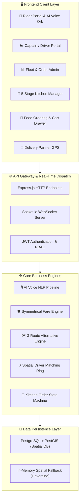
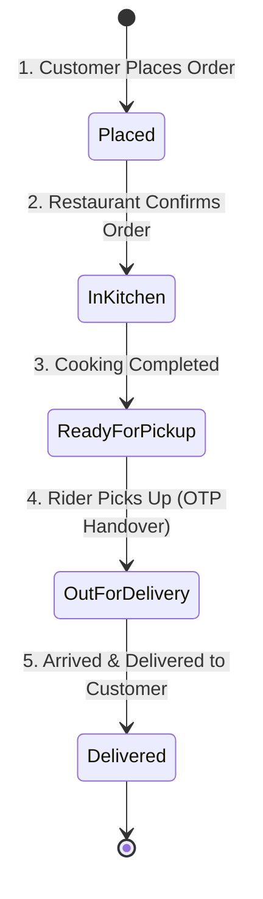

# 📘 EasyWay — Unified Mobility & Food Delivery Super-App
## Comprehensive Technical & Functional Documentation

---

## 📑 Table of Contents

1. [Executive Summary](#1-executive-summary)
2. [Unified Architecture & System Design](#2-unified-architecture--system-design)
3. [Technology Stack](#3-technology-stack)
4. [Platform 1: Rides & Mobility (EasyWay Rides)](#4-platform-1-rides--mobility-easyway-rides)
   - [AI Voice Booking Assistant](#41-ai-voice-booking-assistant)
   - [Symmetrical Canonical Fare Guarantee](#42-symmetrical-canonical-fare-guarantee)
   - [3-Way Alternative Routing Engine](#43-3-way-alternative-routing-engine)
   - [4-Digit Start OTP Security](#44-4-digit-start-otp-security)
   - [Anti-Cancellation Policy](#45-anti-cancellation-policy)
   - [Digital Tax Invoice & Multi-Option Settlement](#46-digital-tax-invoice--multi-option-settlement)
   - [Emergency SOS Safety Center & Lost & Found Desk](#47-emergency-sos-safety-center--lost--found-desk)
5. [Platform 2: Food Delivery (EasyWay Food)](#5-platform-2-food-delivery-easyway-food)
   - [13-Restaurant Catalog & Dynamic Menus](#51-13-restaurant-catalog--dynamic-menus)
   - [Interactive Cart Drawer & Billing](#52-interactive-cart-drawer--billing)
   - [5-Stage Real-Time Kitchen Pipeline](#53-5-stage-real-time-kitchen-pipeline)
   - [Delivery Partner Navigation & Handover OTP](#54-delivery-partner-navigation--handover-otp)
   - [Prepaid Online Multi-App Settlement](#55-prepaid-online-multi-app-settlement)
6. [Database & Spatial Architecture](#6-database--spatial-architecture)
7. [API & WebSocket Specifications](#7-api--websocket-specifications)
8. [Installation, Configuration & Running Guide](#8-installation-configuration--running-guide)
9. [Pre-Seeded Test Credentials & Quick Demo](#9-pre-seeded-test-credentials--quick-demo)

---

## 1. Executive Summary

**EasyWay** is an enterprise-grade, full-stack **Super-App** combining high-frequency urban ride-hailing (**EasyWay Rides**) with multi-vendor food ordering and real-time kitchen tracking (**EasyWay Food**).

The application is engineered with a **dual-engine architecture**:
- **High-Performance Node.js & TypeScript Backend**: Featuring PostGIS spatial queries, in-memory spatial fallback with spherical Haversine mathematics, real-time WebSocket state synchronization, and an AI natural language voice processing pipeline.
- **Interactive Single-Page Application (SPA) Frontend**: Powered by interactive Leaflet maps, Web Speech recognition & synthesis, glassmorphism aesthetics, live GPS telemetry, and automated presentation workflows.

---

## 2. Unified Architecture & System Design



---

## 3. Technology Stack

| Layer | Technologies |
| :--- | :--- |
| **Backend Core** | Node.js (v18+), Express.js (v4.19), TypeScript (v5.5), ESM Modules |
| **Real-Time Layer** | Socket.io (v4.7), WebSockets |
| **Spatial & Storage** | PostgreSQL with PostGIS, In-Memory Spatial Repository (Haversine math fallback) |
| **Mapping & Routing** | Leaflet.js (v1.9.4), OpenStreetMap Tiles, Mock/Google Maps Routing Providers |
| **Voice & Audio** | Web Speech Recognition API (`SpeechRecognition`), Web Speech Synthesis (`SpeechSynthesisUtterance`) |
| **Security & Auth** | JSON Web Tokens (`jsonwebtoken`), Input Validation (`zod`), CORS (`cors`), Dotenv (`dotenv`) |
| **Frontend Styling** | Glassmorphism CSS, Inter Typography, Responsive Flexbox & Grid Layouts |

---

## 4. Platform 1: Rides & Mobility (EasyWay Rides)

### 4.1. AI Voice Booking Assistant
The voice assistant allows riders to book trips, switch vehicles, swap routes, and trigger demos using natural speech.

- **Speech Recognition (`SpeechRecognition` / `webkitSpeechRecognition`)**: Streams real-time spoken transcripts directly into the UI with animated audio sound-waves.
- **Visual State Orb**:
  - 🔵 `IDLE`: Ready for user input.
  - 🔴 `LISTENING`: Actively streaming microphone input.
  - 🟡 `PARSING`: Resolving NLP landmarks, route coordinates, and fares.
  - 🟢 `SPEAKING`: Speaking 2-way audio feedback to the user.
  - 🟠 `MIC ERROR`: Displays friendly fallback chips if mic permissions are blocked.
- **2-Way Audio Voice Responses (TTS)**: Verbalizes route summaries, selected vehicles, and locked symmetrical fares in Indian English via `SpeechSynthesis`.
- **1-Click Quick Voice Chips**: Pre-configured chips for instant execution without microphone access:
  - 📍 `Benz Circle ➔ Station`
  - 🛕 `Durga Temple`
  - 🛍️ `PVP Mall`
  - 🚕 `Prime Cab`
  - 🛵 `Bike Taxi`
  - 🛺 `Auto`
  - ⇅ `Swap Route`
  - ⚡ `30s Live Demo`
- **Voice Commands Guide Modal (`💡 Features`)**: Interactive modal showcasing all supported voice commands with a built-in live command runner.

---

### 4.2. Symmetrical Canonical Fare Guarantee
Traditional ride-hailing apps suffer from asymmetric surge pricing where travelling from Point A to Point B costs differently than Point B to Point A. EasyWay enforces **Symmetrical Canonical Pricing**:

$$\text{Fare}(A \to B) \equiv \text{Fare}(B \to A)$$

#### Mathematical Rule:
1. Coordinates $A$ and $B$ are canonicalized by sorting lat/long pairs deterministically.
2. The canonical distance and duration are hashed to ensure exact pricing parity regardless of trip direction.

#### Vehicle Pricing Matrix:
| Vehicle Type | Base Fare | Per Km Rate | Per Min Rate | Platform Fee |
| :--- | :--- | :--- | :--- | :--- |
| **🛵 Bike Taxi (2-Wheeler)** | ₹15.00 | ₹6.50 | ₹1.00 | ₹3.00 |
| **🛺 Auto Rickshaw (3-Wheeler)**| ₹25.00 | ₹9.00 | ₹1.25 | ₹5.00 |
| **🚕 Prime Cab (4-Wheeler)** | ₹50.00 | ₹14.00 | ₹1.75 | ₹10.00 |

---

### 4.3. 3-Way Alternative Routing Engine
Upon booking acceptance, the map dynamically renders **3 distinct route alternatives**:
- **Way 1 (Primary - Fastest)**: Blue line with lowest travel duration.
- **Way 2 (Eco / Highway)**: Green dashed line optimized for steady speeds.
- **Way 3 (Scenic / Inner Ring)**: Purple dashed line avoiding central congestion.

Riders can click directly on the polylines or the floating **interactive Way Badges** on the map to switch active navigation in real time.

---

### 4.4. 4-Digit Start OTP Security
- When a ride is booked, a unique 4-digit numeric OTP (e.g., `4821`) is generated for the rider.
- The Captain cannot begin the trip until the rider verifies their OTP.
- Verifying the OTP transitions the ride to `IN_PROGRESS` and starts live GPS telemetry.

---

### 4.5. Anti-Cancellation Policy
- **Driver Non-Cancellation Guarantee**: Once a Captain accepts an incoming ride offer, the ride enters a locked state.
- Drivers cannot cancel arbitrarily, preventing rider stranding.
- If a rider cancels post-dispatch, a canonical cancellation compensation is logged for the driver.

---

### 4.6. Digital Tax Invoice & Multi-Option Settlement
Upon trip completion, EasyWay generates an official itemized tax invoice containing:
- **Invoice Number**: e.g., `INV-VJA-2026-8921`
- **Itemized Breakdown**: Base fare, Distance fare, Time fare, Platform fee, CGST (2.5%), SGST (2.5%).
- **Actions**:
  - 📄 **Download PDF Invoice**: Triggers instant digital receipt generation.
  - ✉️ **Email Tax Invoice**: Simulates automated dispatch to the rider's email.
- **Settlement Modes**: Cash, UPI (GPay/PhonePe/Paytm), Credit/Debit Card, FastPay Wallet.

---

### 4.7. Emergency SOS Safety Center & Lost & Found Desk
- **🚨 SOS Safety Modal**:
  - **Loud Audio Siren**: Browser-synthesized emergency sound alarm.
  - **Share Live GPS Link**: Generates an encrypted emergency tracking link.
  - **Police Helpline (112 / 100)**: Instant emergency dispatch simulation.
- **🧳 Lost & Found Desk**: Allows riders to report forgotten items with immediate driver notification.

---

## 5. Platform 2: Food Delivery (EasyWay Food)

### 5.1. 13-Restaurant Catalog & Dynamic Menus
EasyWay Food features 13 restaurants with cuisine tags, ratings, preparation times, and vegetarian/non-vegetarian dishes:
1. **Paradise Biryani** (World Famous Hyderabadi Biryanis)
2. **Minerva Grand** (MG Road, Vijayawada - Andhra Thali & Tiffins)
3. **Nagarjuna Andhra Meals & Biryanis** (Authentic Guntur Spices)
4. **Domino's Gourmet Pizza & Sides** (Italian & Fast Food)
5. **Bawarchi Royal Biryani** (RTC X Roads Specials)
6. **Wow! Momo & Tibetan Kitchen** (Steamed & Fried Momos)
7. **Haldiram's Sweets, Chaats & Thali** (North Indian Snacks & Sweets)
8. **Truffles Gourmet Burgers & Cafe** (American Diner & Shakes)
9. **Corner House Ice Creams** (Death by Chocolate & Desserts)
10. **Vidyarthi Bhavan Heritage** (Crispy Benne Dosa)
11. **Empire Restaurant** (Midnight Kebabs & Shawarmas)
12. **Punjab Grill Royal Kitchen** (North Indian Curries & Naan)
13. **Mainland China & Wok Express** (Authentic Pan-Asian)

---

### 5.2. Interactive Cart Drawer & Billing
- Add/remove items with dynamic increment/decrement buttons.
- Real-time tax and surcharge calculations:
  - **Item Total**
  - **Restaurant Packaging Fee**: ₹25.00
  - **Delivery Partner Fee**: ₹35.00
  - **Platform Service Fee**: ₹5.00
  - **GST Taxes (5%)**: Calculated dynamically
- One-click checkout with prepaid online verification.

---

### 5.3. 5-Stage Real-Time Kitchen Pipeline
Every food order progresses through a 5-stage state machine:



---

### 5.4. Delivery Partner Navigation & Handover OTP
- Delivery partners receive real-time map routes from the restaurant to the customer's doorstep.
- Includes a **4-digit Delivery Handover OTP** to guarantee the parcel is given to the rightful customer.

---

### 5.5. Prepaid Online Multi-App Settlement
- Supports **Google Pay (GPay)**, **PhonePe UPI**, **Paytm UPI**, **Debit/Credit Card**, **FastPay Wallet**, and **NetBanking**.
- Custom orders can be added directly to the Kitchen Queue via the **"+ Place New Prepaid Order"** modal.

---

## 6. Database & Spatial Architecture

EasyWay operates seamlessly in two database modes:
1. **PostGIS Mode (Production)**: When `DATABASE_URL` is available, spatial queries use `ST_DWithin`, `ST_DistanceSphere`, and PostGIS geography types.
2. **In-Memory Spatial Fallback (Development/Zero-Config)**: Automatically active when PostgreSQL is not present. Implements the spherical Haversine formula for distance and nearest-captain spatial indexing.

#### Haversine Spherical Distance Formula:
$$d = 2R \arcsin \left( \sqrt{\sin^2\left(\frac{\Delta \text{lat}}{2}\right) + \cos(\text{lat}_1)\cos(\text{lat}_2)\sin^2\left(\frac{\Delta \text{lng}}{2}\right)} \right)$$
where $R = 6371\text{ km}$.

---

## 7. API & WebSocket Specifications

### 7.1. REST API Endpoints

| Method | Endpoint | Description | Request Body |
| :--- | :--- | :--- | :--- |
| `GET` | `/api/v1/health` | Service health & PostGIS status | _None_ |
| `POST` | `/api/v1/fare/calculate` | Symmetrical fare calculation | `{ pickup: LocationPoint, drop: LocationPoint }` |
| `POST` | `/api/v1/rides/voice-book` | AI Voice NLP booking pipeline | `{ speechText, userLat, userLng, vehicleType }` |
| `POST` | `/api/v1/rides/request` | Standard ride creation | `{ vehicleType, pickup, drop, paymentMode }` |
| `POST` | `/api/v1/rides/:id/accept` | Captain accepts ride offer | `{ captainId }` |
| `POST` | `/api/v1/rides/:id/verify-otp` | Verify 4-digit ride start OTP | `{ otp }` |
| `POST` | `/api/v1/rides/:id/complete` | Complete ride & generate invoice | `{ paymentMode }` |
| `GET` | `/api/v1/food/restaurants` | List all 13 restaurants | _None_ |
| `POST` | `/api/v1/food/orders` | Create new food order | `{ restaurantId, items, paymentMode }` |

### 7.2. WebSocket Real-Time Events (`Socket.io`)

| Event Name | Direction | Payload Description |
| :--- | :--- | :--- |
| `join_ride_room` | Client ➔ Server | Joins real-time ride room for status updates |
| `driver_location_update` | Client ➔ Server | Live GPS telemetry `{ lat, lng, heading, rideId }` |
| `ride_offer_received` | Server ➔ Client | Dispatches incoming booking offer to nearby captains |
| `ride_status_change` | Server ➔ Client | Broadcasts transitions (`ACCEPTED`, `ON_TRIP`, `COMPLETED`) |
| `kitchen_order_update` | Server ➔ Client | Broadcasts food 5-stage progress updates |

---

## 8. Installation, Configuration & Running Guide

### 8.1. Prerequisites
- **Node.js**: v18.0.0 or higher
- **npm**: v9.0.0 or higher
- *(Optional)* PostgreSQL 14+ with PostGIS extension

### 8.2. Setup Instructions

```bash
# 1. Clone the repository and navigate into backend
cd backend

# 2. Install dependencies
npm install

# 3. Configure environment variables (.env)
# ALLOW_IN_MEMORY_FALLBACK=true allows running without PostgreSQL!
PORT=4000
NODE_ENV=development
JWT_SECRET=ridego_jwt_dev_secret_key_change_in_production_98765
ALLOW_IN_MEMORY_FALLBACK=true
MAP_PROVIDER=mock
TEST_OTP=123456

# 4. Start the application
npm start
```

### 8.3. Access URLs
- **Main Super-App**: [http://localhost:4000](http://localhost:4000)
- **Interactive Test Console**: [http://localhost:4000/test-console](http://localhost:4000/test-console)
- **Health Check API**: [http://localhost:4000/api/v1/health](http://localhost:4000/api/v1/health)

---

## 9. Pre-Seeded Test Credentials & Quick Demo

### 🔑 Test User Accounts (Dev OTP: `123456`)
- **Rider (Rahul)**: `9876543210`
- **Bike Captain (Ramesh)**: `9876543211`
- **Auto Captain (Suresh)**: `9876543212`
- **Cab Captain (Vikram)**: `9876543213`

### ⚡ 30-Second Live Simulation Demo
1. Open [http://localhost:4000](http://localhost:4000) in your browser.
2. Click **"⚡ Run 30s Live Demo"** in the top navigation bar.
3. Watch the automated end-to-end presentation of voice dispatch, driver acceptance, OTP verification, GPS route simulation, 5-stage food prep, and digital tax invoice settlement!
